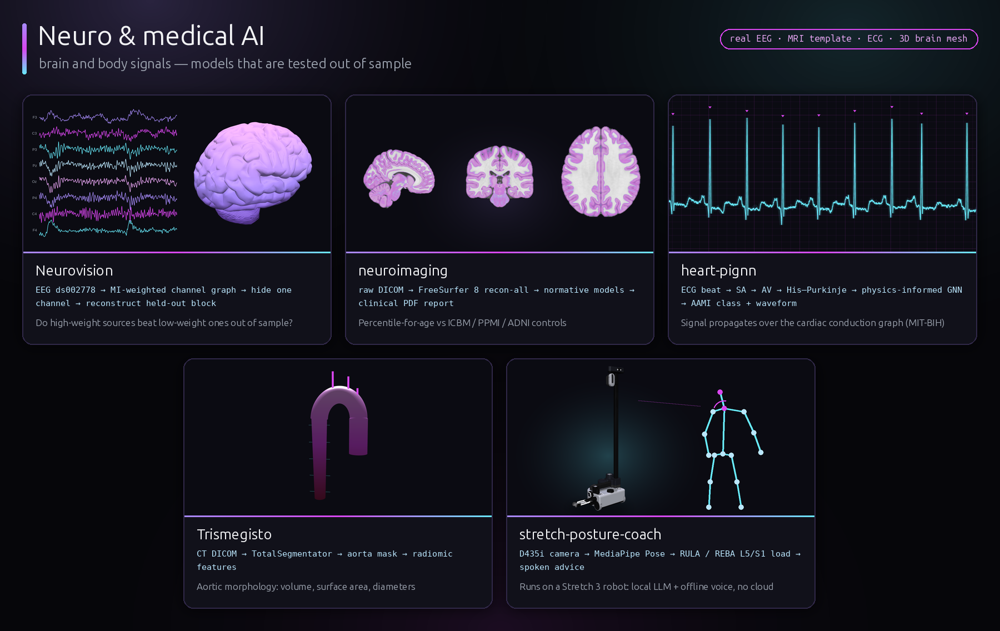
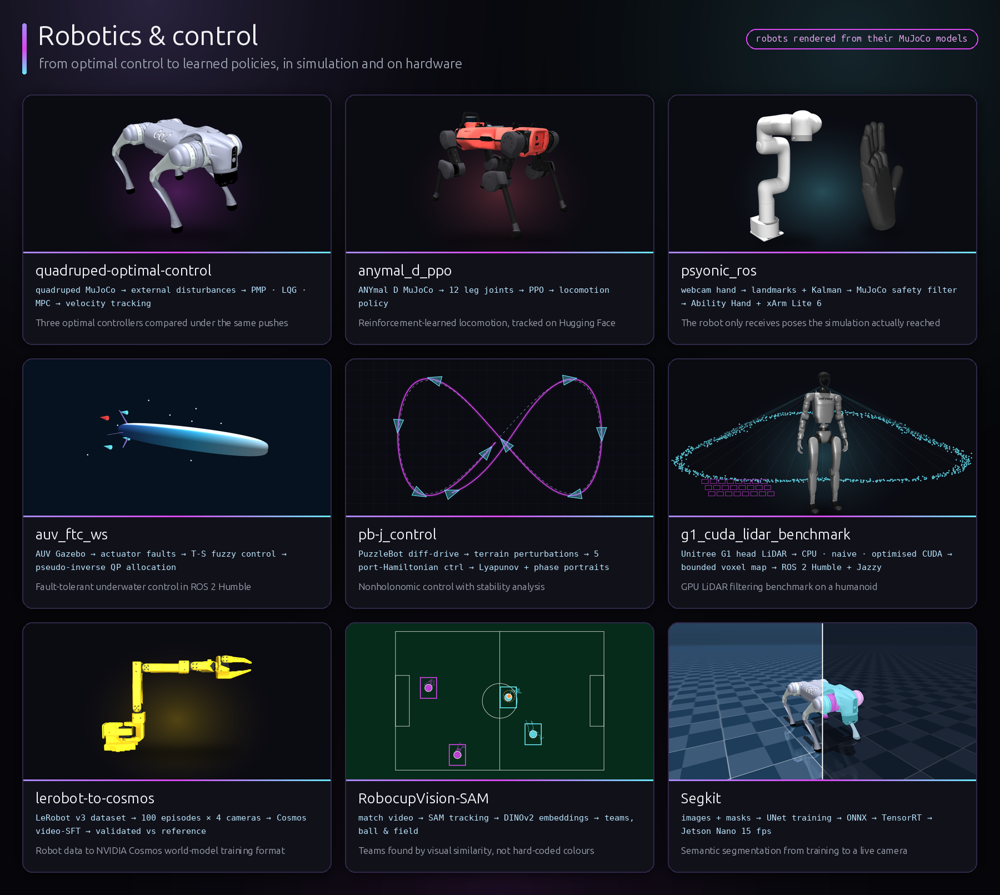
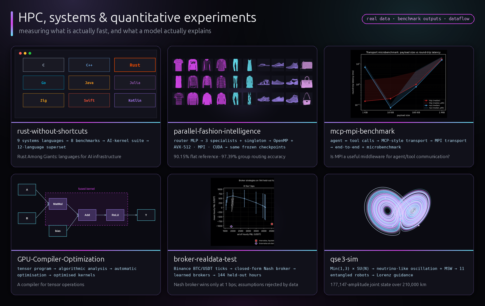

# Nezih Nieto Gutiérrez

**Robotics · neuroadaptive AI · scientific computing.**
I build systems where learning meets the physical world: brain signals that adapt robot training, legged and humanoid robots that learn to move, and medical-imaging pipelines that turn raw scans into clinical reports. MCC, Tecnológico de Monterrey.

I like projects that are measured honestly: held-out evaluation, real baselines, and a clear statement of what a result does *not* show.

---

### Neuro & medical AI

| Project | What it does |
|---|---|
| [**Neurovision**](https://github.com/nezih-niegu/Neurovision) | Do mutual-information edge weights on an EEG graph predict anything out of sample? Hides one channel and reconstructs it from high- vs low-weight sources (OpenNeuro ds002778). |
| [**neuroimaging**](https://github.com/nezih-niegu/neuroimaging) | MRI from raw DICOMs to a percentile-for-age clinical report: FreeSurfer 8 → normative models (ICBM / PPMI / ADNI) → CDISC-compliant PDF, with MNE-Python visualisation. |
| [**heart-pignn**](https://github.com/nezih-niegu/heart-pignn) | Physics-informed graph neural network: ECG beats propagate over the cardiac conduction graph (SA → AV → His–Purkinje) for MIT-BIH beat classification and waveform regression. |
| [**Trismegisto**](https://github.com/nezih-niegu/Trismegisto) | CT aorta segmentation (TotalSegmentator) and radiomic / morphological feature extraction. |
| [**stretch-posture-coach**](https://github.com/nezih-niegu/stretch-posture-coach) | A Hello Robot Stretch 3 watches your posture (MediaPipe), scores RULA/REBA and spinal loads, and tells you out loud how to fix it; local LLM + offline voice, no cloud. |

### Robotics & control

| Project | What it does |
|---|---|
| [**quadruped-optimal-control**](https://github.com/nezih-niegu/quadruped-optimal-control) | PMP vs LQG vs MPC for quadruped stabilisation and velocity tracking under disturbances, in MuJoCo. |
| [**anymal_d_ppo**](https://github.com/nezih-niegu/anymal_d_ppo) | PPO locomotion for ANYbotics ANYmal D in MuJoCo, tracked with the Hugging Face stack. |
| [**psyonic_ros**](https://github.com/nezih-niegu/psyonic_ros) | Webcam hand tracking → PSYONIC Ability Hand + xArm Lite 6, with MuJoCo physics in the command path as a safety filter. |
| [**auv_ftc_ws**](https://github.com/nezih-niegu/auv_ftc_ws) | Fault-tolerant AUV control (Takagi–Sugeno fuzzy + pseudo-inverse QP allocation) in ROS 2 Humble + Gazebo. |
| [**pb-j_control**](https://github.com/nezih-niegu/pb-j_control) | Five port-Hamiltonian / nonholonomic controllers for a differential-drive robot, with Lyapunov analysis and phase portraits. |
| [**g1_cuda_lidar_benchmark**](https://github.com/nezih-niegu/g1_cuda_lidar_benchmark) | Unitree G1 head-LiDAR filtering and voxel mapping: CPU vs naive vs optimised CUDA, ROS 2 Humble + Jazzy. |
| [**lerobot-to-cosmos**](https://github.com/nezih-niegu/lerobot-to-cosmos) | Converts a LeRobot v3 dataset into NVIDIA Cosmos video-SFT format, validated against the reference dataset. |
| [**RobocupVision-SAM**](https://github.com/nezih-niegu/RobocupVision-SAM) · [**Segkit**](https://github.com/nezih-niegu/Segkit) | Robot-soccer team clustering with SAM + DINOv2; UNet segmentation from training to a real-time TensorRT Jetson Nano. |

### HPC, systems & quantitative experiments

| Project | What it does |
|---|---|
| [**rust-without-shortcuts**](https://github.com/nezih-niegu/rust-without-shortcuts) | *Rust Among Giants*: 9 systems languages × 8 benchmarks plus an AI-kernel suite, for high-performance AI infrastructure. |
| [**parallel-fashion-intelligence**](https://github.com/nezih-niegu/parallel-fashion-intelligence) | A hierarchical Fashion-MNIST classifier served by PyTorch, a custom OpenMP + AVX-512 backend, MPI and CUDA/cuDNN. |
| [**mcp-mpi-benchmark**](https://github.com/nezih-niegu/mcp-mpi-benchmark) | Is MPI a useful middleware for MCP-style agent/tool communication? End-to-end and transport microbenchmarks. |
| [**GPU-Compiler-Optimization**](https://github.com/nezih-niegu/GPU-Compiler-Optimization) | A compiler that automatically optimises tensor operations. |
| [**broker-realdata-test**](https://github.com/nezih-niegu/broker-realdata-test) | Tests a closed-form broker–trader Nash equilibrium and learned brokers on 144 held-out hours of Binance BTC/USDT ticks. |
| [**qse3-sim**](https://github.com/nezih-niegu/qse3-sim) | A speculative nanoscale robot on `Min(1,3) × SU(N)` propagating under neutrino-like physics, with real oscillation parameters. |

---

### Tools I use
**Languages** · Python · C / C++ · CUDA · Rust · R · TypeScript · Dart
**ML** · PyTorch · Hugging Face · diffusion models · PPO / imitation learning · graph neural networks
**Robotics** · ROS 2 · MuJoCo · Gazebo · dVRK / AMBF · Jetson / TensorRT
**Neuro & medical** · EEG (MNE-Python) · FreeSurfer · TotalSegmentator · pyradiomics
**Systems** · OpenMP · MPI · AVX-512 · uv · Docker

---

Visuals: robots rendered from their MuJoCo models (MuJoCo Menagerie, ANYbotics, PSYONIC), real EEG (OpenNeuro ds002778), ECG (MIT-BIH record 100), MNI152 template, Fashion-MNIST and each repo's own outputs. Generated by <code>scripts/heroes.py</code> and <code>scripts/compose.py</code>.
